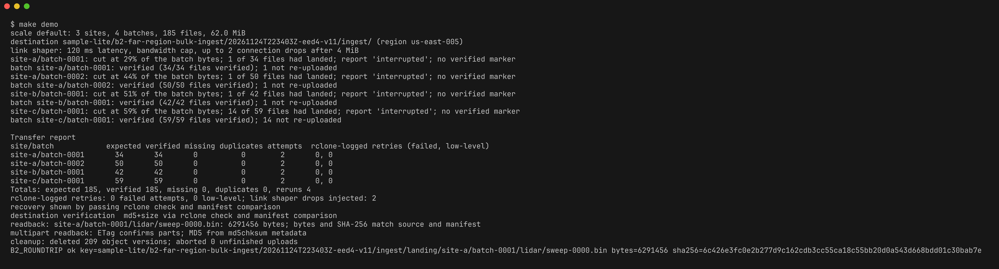

# b2-far-region-bulk-ingest

<!-- Replace this paragraph: one or two sentences on what the sample does and why Backblaze B2 matters in it. -->
A Python sample that stores its data in [Backblaze B2 Cloud Storage](https://www.backblaze.com/sign-up/ai-cloud-storage?utm_source=github&utm_medium=referral&utm_campaign=ai_artifacts&utm_content=b2ai-far-region-bulk-ingest) through the official `boto3` SDK.

## Quick start

```bash
make setup
cp .env.example .env   # then fill in your B2 values
make demo
```

`make demo` runs the main flow against your bucket and prints one line like:

```
B2_ROUNDTRIP ok key=sample-lite/b2-far-region-bulk-ingest/<nonce>/<name> bytes=<n> sha256=<hex>
```



## How it works

<!-- Replace: the main flow step by step, naming the SDK calls it makes. -->

## When to use

<!-- Replace: the situations this sample fits. -->

## When not to use

<!-- Replace: the situations where another approach fits better. -->

## FAQ

**Does `make test` need B2 credentials?**
No. `make test` runs offline. Only `make demo` talks to B2.

**What does the demo write to my bucket?**
Only objects under `sample-lite/b2-far-region-bulk-ingest/<nonce>/`, and it deletes exactly the objects it wrote before it exits.

## License

MIT, see [LICENSE](LICENSE).
